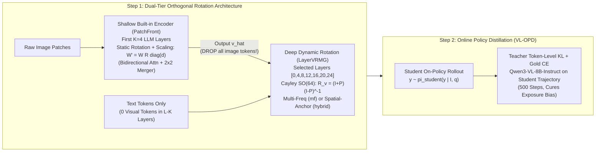

# SpinVL: Vision-Tower-Free & Zero-Visual-Token Multimodal LLMs via Dual-Tier Orthogonal Rotation and Online Policy Distillation

> **Target Venue**: CVPR 2027  
> **Base Models**: Frozen `Qwen3-0.6B` / `Qwen3-1.7B` / `Qwen3-8B`  
> **Teacher Model**: `Qwen3-VL-8B-Instruct`  
> **Status**: All experimental phases (`P1`–`P18` & `bench_eval_v4`) completed.

---

## 1. Motivation (Why SpinVL?)

Existing Vision-Language Models (VLMs) face a fundamental tension between **inference efficiency**, **architectural simplicity**, and **language capability preservation**:

1. **Token-Concatenation VLMs (e.g., LLaVA)** attach a heavy external vision tower and prepend hundreds or thousands of visual tokens to the text sequence across all $L$ layers of the LLM.
   - **Drawbacks**: Self-attention FLOPs and KV-cache grow quadratically/linearly with image resolution (**9.85 TFLOPs** at 4096 patches for a 1.7B LLM), and fine-tuning the LLM backbone degrades its original pure-text reasoning and mathematical abilities.
2. **Parameter-Rotation VLMs (e.g., ROSE)** eliminate visual tokens from the LLM backbone by mapping visual features into block-diagonal Cayley orthogonal matrices $R_v \in SO(b)$ that rotate linear layer inputs ($x R_v$).
   - **Drawbacks**: ① Still relies on a bulky external vision tower; ② Single-frequency global pooling loses spatial granularity; ③ Offline teacher-forcing training suffers from severe **exposure bias** during autoregressive generation (rambling or failing to emit EOS).
3. **Tower-Free Early-Layer Encoders (e.g., VoRA)** remove the external vision tower by repurposing the first $K$ LLM layers with LoRA adapters to encode image patches.
   - **Drawbacks**: Visual tokens remain inside the LLM backbone across all deeper layers (no inference FLOPs saved), and merging additive LoRA weights into the first $K$ layers catastrophically destroys pure-text math reasoning (`GSM8K` drops from **70.4% $\to$ 0.0%** in our controlled ablation).

### Our Core Question
> **Can we turn a frozen pure-text LLM into a VLM that (1) requires NO external vision tower, (2) feeds ZERO visual tokens into the deeper LLM backbone (saving 74% FLOPs), (3) preserves 100% bit-exact pure-text performance, and (4) matches or outperforms token-concatenation LLaVA on visual perception, anti-hallucination, and mathematical reasoning?**

---

## 2. Method Overview (Two-Step Framework)

SpinVL keeps the base pure-text LLM **100% frozen** and introduces a two-step framework:



### Step 1: Dual-Tier Orthogonal Rotation (`SpinVL-Tower` & `SpinVL-Free`)

1. **Tier 1 — Shallow Built-in Vision Frontend (`PatchFront`, `rots_K4`, used in `SpinVL-Free`)**:
   - Removes the external vision tower completely. Raw image patches are projected and processed by the student LLM's own first $K=4$ layers under **bidirectional attention**.
   - Instead of additive LoRA, we apply **Static Orthogonal Rotation + Channel-wise Diagonal Scaling**:
     $$W' = W \, R_{\text{static}} \, \operatorname{diag}(d), \quad R_{\text{static}} = (I + P)(I - P)^{-1} \in SO(64)$$
     using only **2.4M** static adapter parameters. Diagonal scaling $\operatorname{diag}(d)$ compensates for the singular-value invariance of pure orthogonal rotations while preserving angular geometry.
   - After layer $K=4$, $2\times 2$ patch merging produces cell features $\hat{v} \in \mathbb{R}^{N_c \times d_v}$, and **all image patch tokens are immediately discarded**.
   - **Modality Decoupling**: During pure-text inference, the vision switch is off (`_STATIC = None, _CTX = None`), guaranteeing **100% bit-exact equivalence** to the original pure-text LLM (`GSM8K 70.4%`, `ARC-C 71.4%`).

2. **Tier 2 — Deep Dynamic Rotation Injection (`LayerVRMG`, 0 Visual Tokens in Backbone)**:
   - At 7 selected LLM layers (`[0,4,8,12,16,20,24]` for 0.6B/1.7B; `[0,5,10,15,20,25,30]` for 8B), `LayerVRMG` maps visual features ($v$ from the frozen teacher tower in `SpinVL-Tower`, or $\hat{v}$ from `PatchFront` in `SpinVL-Free`) to block-diagonal orthogonal matrices $R_v \in SO(64)$ for all 7 linear projections (`q/k/v/o/gate/up/down`):
     $$z = (x \, R_v) W^\top$$
   - To overcome the spatial bottleneck of single-frequency ROSE, we introduce two variants:
     - **`multifreq` (`mf`)**: Splits rotation blocks into Low-frequency (25%, global mean pooled), Mid-frequency (37.5%, 2D sinusoidal PE with base 10000), and High-frequency (37.5%, 2D PE with base 50 and sharp temperature $\tau=0.25$) bands, modulated by a zero-initialized text gate $2\sigma(g(x))$. Excels at multi-step visual math (`MathVista`).
     - **`hybrid`**: Combines block-diagonal orthogonal rotation $x R_v$ with a lightweight 256-dim cross-attention over $M=16$ learnable spatial anchors pooled from the visual features, added back via a zero-initialized residual projection. Excels at fine-grained perception and hallucination resistance (`MMStar`, `HallusionBench`).

### Step 2: Online Policy Distillation (`VL-OPD`)
- Offline teacher-forcing (`CE`) leaves rotation-injected models vulnerable to **autoregressive exposure bias** (once the student generates its own first token, hidden states drift and the model rambles or fails to emit EOS).
- In `VL-OPD` (`scripts/train_opd.py` and `scripts/train_joint_opd.py`), the student generates on-policy rollouts $\hat{y}_{1:T} \sim \pi_\theta(\cdot \mid I, q)$, and the `Qwen3-VL-8B-Instruct` teacher evaluates the student's exact trajectory in a single forward pass to supervise it with **full-vocabulary token-level forward KL divergence + gold-answer CE anchoring** (+ $\hat{v}$ feature alignment in `SpinVL-Free`) for 500 steps.

---

## 3. Headline Experimental Results (`bench_eval_v4`)

All models below use the **same frozen student backbone (`Qwen3-1.7B`)** and are evaluated zero-shot across 6 public benchmarks (`MMStar`, `HallusionBench`, `MathVista testmini`, `Geometry3K test`, `ChartQA`, `OCRBench`) plus efficiency and language retention benchmarks.

### 3.1 Main Comparison Table (`Qwen3-1.7B` & Cross-Size `0.6B / 8B`)

| Category | Model | External Vision Tower | Backbone Vis Tokens | FLOPs (@4096p) | Pure-Text GSM8K | **MMStar** (1500) | **Hallusion** (951) | **MathVista** (1000) | **Geo3K** (Gen / 1st-Tok) | **MC2 Avg** (Perc.+Hallu) | **Core3 Avg** (MMStar+Hallu+MV) | **6-Bench Avg** |
|---|---|---|---:|---:|---:|---:|---:|---:|---:|---:|---:|---:|
| **Token-Concat Upper Bound** | `LLaVA-Proj (21k mix)` | 8B Vis Tower | All 28 Layers | 9.85T | 70.4% | 29.60% | 53.10% | 24.90% | **6.49%** / — | 41.35% | 35.87% | **21.02%** |
| **Token-Concat Upper Bound** | `LLaVA-Proj (28k P15)` | 8B Vis Tower | All 28 Layers | 9.85T | 70.4% | 29.27% | 54.15% | **25.00%** | 5.49% / — | 41.71% | 36.14% | 20.89% |
| **Rotation Baseline** | `ROSE Single-Freq` | 8B Vis Tower | **0** | 6.82T | 70.4% | 25.60% | 54.36% | 19.70% | 2.00% / 95.8% | 39.98% | 33.22% | 17.14% |
| **Tower-Free Baseline** | `VoRA-style (LoRA K=4)` | **None** | **0** (L5–28) | 2.54T | 70.4% (0.0% merged) | 23.73% | 49.95% | 18.50% | 1.33% / — | 36.84% | 30.73% | 15.82% |
| **🌟 Ours (Tower)** | **`SpinVL-Tower (hybrid)`** | 8B Vis Tower | **0** | 6.82T | **70.4%** | **30.60%** | **58.15%** | 18.50% | 1.83% / **96.0%** | **44.37% (+3.0%)** | 35.75% | 18.36% |
| **🌟 Ours (Tower+OPD)** | **`SpinVL-Tower (mf + OPD, P15)`** | 8B Vis Tower | **0** | 6.82T | **70.4%** | 26.80% | **57.41%** | **23.50%** | 2.00% / **96.3%** | **42.11%** | **35.90% (beats LLaVA)** | **18.50%** |
| **🌟 Ours (Tower-Free)** | **`SpinVL-Free + OPD (hybrid)`** | **None (-74% FLOPs)** | **0** (L5–28) | **2.54T** | **70.4%** | 27.93% | **56.99%** | 19.80% | 2.16% / — | **42.46% (beats LLaVA)** | **34.91%** | **18.02%** |
| **🌟 Ours (Tower-Free)** | **`SpinVL-Free + OPD (P15 s2)`** | **None (-74% FLOPs)** | **0** (L5–28) | **2.54T** | **70.4%** | **29.20%** | **56.15%** | 19.50% | 1.00% / — | **42.68% (beats LLaVA)** | **34.95%** | 17.80% |
| **🌟 Ours (Tower-Free E2E)** | **`SpinVL-Free (P16 no-align)`** | **None (-74% FLOPs)** | **0** (L5–28) | **2.54T** | **70.4%** | 27.53% | **57.73%** | 19.40% | 2.66% / — | **42.63% (beats LLaVA)** | **34.89%** | **18.13%** |
| **🌟 Ours (0.6B Tower-Free)** | **`0.6B SpinVL-Free + OPD`** | **None (-74% FLOPs)** | **0** (L5–28) | **0.91T** | **100% Kept** | **27.53%** | **57.83%** | 18.60% | 2.16% / **96.2%** | **42.68% (beats 1.7B LLaVA)** | **34.66%** | **18.05%** |
| **🌟 Ours (8B Tower-Free)** | **`8B SpinVL-Free (hybrid, P15)`** | **None (-74% FLOPs)** | **0** (L5–28) | — | **100% Kept** | **27.40%** | **56.99%** | **19.20%** | 2.50% / **96.2%** | **40.90%** | **33.66%** | **17.50%** |

### 3.2 Key Takeaways
1. **Beats LLaVA on Perception, Anti-Hallucination, and Core-3 Reasoning with 0 Backbone Visual Tokens**:
   - `SpinVL-Tower (hybrid)` achieves **44.37%** on `MC2` (`MMStar + HallusionBench`), outperforming full-token `LLaVA-Proj` (**41.35%**) by **+3.02%**.
   - `SpinVL-Tower (mf + OPD)` boosts `MathVista` to **23.50%** and reaches **35.90%** on `Core3` (`MMStar + Hallusion + MathVista`), surpassing `LLaVA-Proj` (**35.87%**).
   - Even **without any external vision tower**, `SpinVL-Free + OPD` achieves **42.68%** on `MC2` (surpassing `LLaVA-Proj`) and retains **97.4%** of `LLaVA-Proj`'s `Core3` score while **saving 74.2% FLOPs** and running **20% faster** in wall-clock latency (`99.4 ms` vs `123.4 ms` at 4096 patches).
2. **Decisively Outperforms ROSE and VoRA**:
   - Beats single-frequency `ROSE` by **+4.39%** on `MC2` and **+2.68%** on `Core3`.
   - Beats same-architecture `VoRA (LoRA K=4)` by **+5.84%** on `MC2`, **+4.22%** on `Core3`, and **+2.20%** on 6-bench average (`18.02%` vs `15.82%`).
3. **Step 2 (`VL-OPD`) Cures Exposure Bias in Free Generation**:
   - Under forced free-form greedy decoding (`--force-gen`), `VL-OPD` boosts `0.6B SpinVL-Free` by **+7.67%** on `MMStar` (`14.53% -> 22.20%`), **+9.89%** on `HallusionBench` (`23.55% -> 33.44%`), and **+4.70%** on `MathVista` (`9.70% -> 14.40%`), while raising EOS termination rate to **95%–100%**.
4. **Clear Mechanism Boundary (`ChartQA / OCRBench`)**:
   - Controlled same-data training (`P15`, adding 6,500 `DocVQA` chart/table/OCR samples + 1,834 `GQA` + 2,101 `Geometry3K`) doubles `SpinVL`'s `Geometry3K` score (`1.83% -> 3.83%`), while `ChartQA` remains at `10.32%` for `LLaVA-Proj` (vs `10.40%` before) and `1.24%–2.60%` for `SpinVL`. This establishes a clear mechanism boundary: **0-token orthogonal rotation acts as a global/mid-grained operator modulation (ideal for visual perception, spatial reasoning, and hallucination suppression), whereas dense character-level OCR transcription requires token-level KV addressing.**

---

## 4. Repository Structure

```text
spinvl/
├── README.md                          # Project overview, method, headline results, and quick start
├── FINAL_REPORT.md                    # Complete P1-P18 experimental report & all tables with JSON provenance
├── docs/
│   └── ARCHITECTURE_AND_CODE_GUIDE.md # Module-by-module code guide, math formulas & post-mortems
├── src/
│   ├── vrmg.py                        # LayerVRMG (Cayley SO(b), multifreq, tokrot, hybrid) & RotatedLinear
│   ├── front.py                       # PatchFront (built-in K-layer vision encoder: rot, rots, lora, full)
│   ├── wrap.py                        # Non-invasive LLM wrapper (attach_rotation, rotation_context_with)
│   └── imgdata.py                     # Multi-source image + memmap teacher feature dataset utilities
├── scripts/
│   ├── build_mix.py                   # Build 24k VQA mix dataset from DeepEyes-47k
│   ├── build_open_supp.py             # Build 8.3k open-ended DocVQA/GQA supplement from Visual-CoT
│   ├── prepare_big.py                 # Extract teacher vision features & top-k logits into memmap shards
│   ├── train_final.py                 # Stage 1: Train SpinVL-Tower (ce / kd / rel, multifreq / hybrid)
│   ├── train_front.py                 # Stage 2A: Warm-up PatchFront (rot / rots / lora / full, K=0..8)
│   ├── train_joint.py                 # Stage 2B: End-to-end joint training of SpinVL-Free (PatchFront + VRMG)
│   ├── train_opd.py                   # Step 2 (Tower): Online Policy Distillation (VL-OPD) for SpinVL-Tower
│   ├── train_joint_opd.py             # Step 2 (Free): Online Policy Distillation (VL-OPD) for SpinVL-Free
│   ├── train_proj.py                  # Baseline: Standard LLaVA token-concatenation MLP projector
│   ├── eval_benchmarks.py             # Unified 6-benchmark zero-shot evaluation (MMStar/Hallu/Chart/OCR/MV/Geo3K)
│   ├── bench_data.py                  # Benchmark data loaders & prompt templates
│   ├── bench_models.py                # Unified inference runner (tower / tower_free / proj)
│   ├── bench_score.py                 # Official metric scorers & Wilson 95% CI
│   ├── bench_efficiency.py            # Analytical FLOPs + exclusive-GPU latency profiler (256..4096 patches)
│   ├── eval_lang.py                   # Pure-text capability retention evaluation (GSM8K & ARC-Challenge)
│   └── aggregate.py                   # Auto-aggregator for generating FINAL_REPORT.md from results/
├── queue/
│   ├── worker.py                      # Multi-GPU priority + EASY-backfill job scheduler over shared storage
│   ├── enqueue.py                     # Job definitions for Phases P1-P9
│   ├── enqueue_p10.py                 # Job definitions for Phases P10-P11 (VoRA, Tower-OPD, 0.6B/8B scaling)
│   └── enqueue_p15.py                 # Job definitions for Phase P15 (same-data open-ended supplement pipeline)
├── results/
│   ├── bench_eval_v4/                 # Final 6-benchmark evaluation JSONs (49 model/ablation evaluations)
│   ├── bench_eval_v3/                 # Earlier v3 6-benchmark evaluation JSONs (69 evaluations)
│   └── p1/ .. p18/                    # All training & internal evaluation JSONs across Phases P1-P18
└── tests/
    └── test_vrmg.py                   # Unit tests for Cayley orthogonality, gradient flow, and wrapper
```

---

## 5. Reproduction Commands

### 5.1 Stage 1: Train `SpinVL-Tower` (`train_final.py`)
```bash
python scripts/train_final.py \
  --arm ce \
  --data "/path/to/data/mix/shard*.meta.pt,/path/to/data/open_supp/shard*.meta.pt,/path/to/data/geo_8b.pt" \
  --model "/path/to/Qwen3-1.7B" \
  --layers "0,4,8,12,16,20,24" --block 64 --query-dim 256 \
  --bs 8 --seq 256 --steps 6000 --limit 28000 --hybrid \
  --test-data "/path/to/data/geo_8b_test.pt" \
  --log results/p15/p15_q17_tower_hybrid_ce.log \
  --result-json results/p15/p15_q17_tower_hybrid_ce.json
```

### 5.2 Stage 2A & 2B: Train `SpinVL-Free` (`train_front.py` $\to$ `train_joint.py`)
```bash
# Stage 2A: Warm-up built-in frontend (rots, K=4)
python scripts/train_front.py \
  --mode rots --K 4 \
  --source "/path/to/mix/shard*.meta.pt|/path/to/mix/manifest.jsonl|/path/to/mix" \
  --steps 2500 --bs 16 --out results/p6/p6_rots_K4

# Stage 2B: End-to-end joint training (PatchFront + LayerVRMG, no external vision tower)
python scripts/train_joint.py \
  --stage joint --front-mode rots --K 4 --arm ce --hybrid \
  --data "/path/to/data/mix/shard*.meta.pt" \
  --source "/path/to/mix/shard*.meta.pt|/path/to/mix/manifest.jsonl|/path/to/mix" \
  --vrmg-ckpt results/p8/p8_hybrid_n21000_s0_pt.pt \
  --front-ckpt results/p6/p6_rots_K4.pt \
  --seq 256 --bs 8 --steps 2500 --out results/p8/p8_hybrid_rots_joint
```

### 5.3 Step 2: Online Policy Distillation (`VL-OPD`)
```bash
# For SpinVL-Tower:
python scripts/train_opd.py \
  --data "/path/to/data/mix/shard*.meta.pt" \
  --source "/path/to/mix/shard*.meta.pt|/path/to/mix/manifest.jsonl|/path/to/mix" \
  --vrmg-ckpt results/p15/p15_q17_tower_mf_ce_pt.pt \
  --multifreq --steps 500 --bs 4 --max-new 16 --lr 2e-5 --ce-weight 0.5 \
  --out results/p15/p15_q17_tower_mf_opd

# For SpinVL-Free:
python scripts/train_joint_opd.py \
  --data "/path/to/data/mix/shard*.meta.pt" \
  --source "/path/to/mix/shard*.meta.pt|/path/to/mix/manifest.jsonl|/path/to/mix" \
  --joint-ckpt results/p8/p8_hybrid_rots_joint.pt \
  --hybrid --steps 500 --bs 4 --max-new 16 --lr-vrmg 2e-5 --lr-front 1e-5 \
  --ce-weight 0.5 --feat-weight 0.2 \
  --out results/p9/p9_opd_hybrid_rots
```

### 5.4 Public 6-Benchmark Evaluation & Efficiency / Language Retention
```bash
# Evaluate on MMStar, HallusionBench, ChartQA, OCRBench, MathVista, Geometry3K
python scripts/eval_benchmarks.py \
  --mode tower_free \
  --ckpt results/p9/p9_opd_hybrid_rots.pt \
  --name q17_free_hybrid_opd \
  --out-dir results/bench_eval_v4

# Analytical FLOPs & Latency across 256..4096 patches
python scripts/bench_efficiency.py --K 4 --front-ckpt results/p3/p3_rot_K4.pt --out results/p18/bench_K4_clean.json

# Pure-Text GSM8K & ARC-Challenge retention
python scripts/eval_lang.py --K 4 --out results/p18/lang_K4_full.json
```

---

## 6. Further Documentation
- **[`FINAL_REPORT.md`](./FINAL_REPORT.md)**: Full experimental tables across Phases `P1`–`P18`, ablation studies, multi-seed error bars, and negative-result post-mortems.
- **[`docs/ARCHITECTURE_AND_CODE_GUIDE.md`](./docs/ARCHITECTURE_AND_CODE_GUIDE.md)**: Deep-dive into the mathematical formulation, code implementation details, checkpoint schemas, and engineering lessons.
